# マルチエージェントシステム 通信シーケンス図（テストケース別）

本ドキュメントは、Postman テストコレクションの起動時ディスカバリ（0-A）および各テストケース（ケース 0〜5）における、クライアント・オーケストレーター（`main-agent`）・Azure OpenAI・サブエージェント（`hr-agent` / `it-agent` / `salesforce-agent`）・MCP サーバー間の通信シーケンスと送受信パラメータの詳細仕様をまとめたものです。

---

## 0-A. 【共通】起動時 / 未取得時の Agent Card 動的ディスカバリ

`main_agent/main.py` の起動時（`lifespan`）および `main_agent/agent.py` の `discover_agents()` によるサブエージェントのスキル自動取得と OpenAI Function Calling ツール定義への変換シーケンスです。

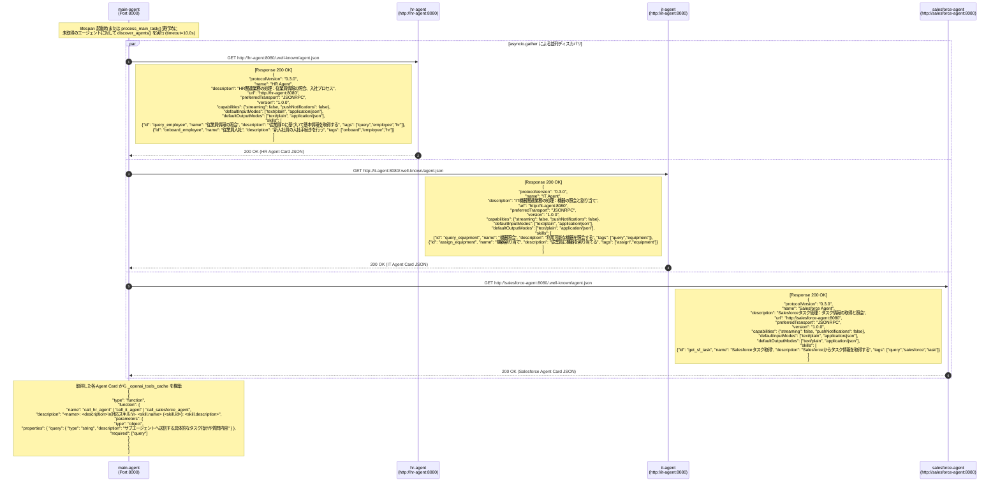

---

## テストケース 0：ヘルスチェック (`GET /health`)

`main_agent/main.py` の稼働確認シーケンスです。

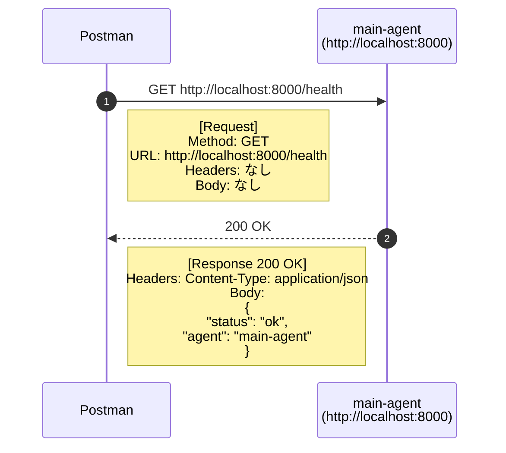

---

## テストケース 1：HR エージェント単体（従業員情報の照会）

`main-agent` から `hr-agent`（`hr_agent/main.py`、`hr_agent/agent.py`）へ A2A で委譲し、`mcp-server`（`mcp_server/main.py`）の `get_employee_info` を実行するシーケンスです。

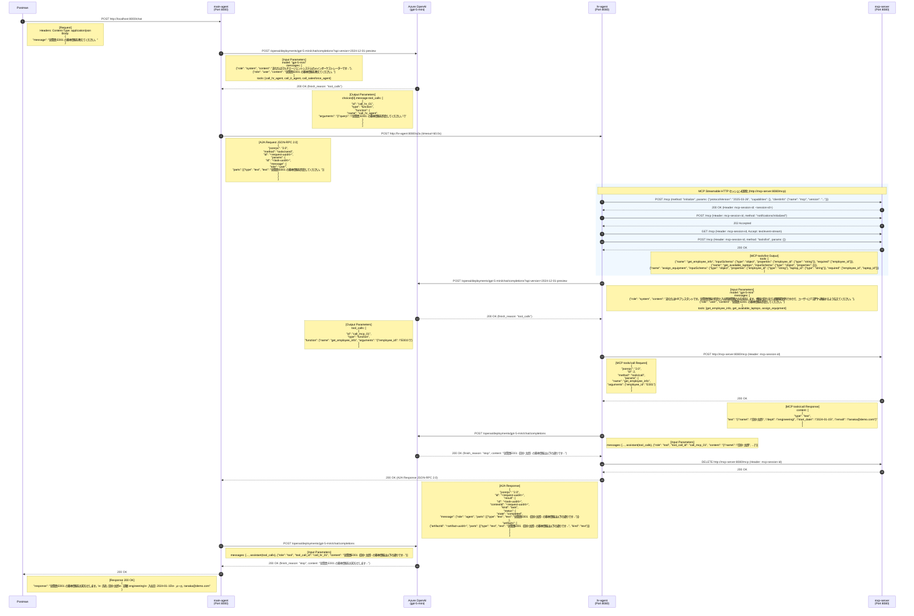

---

## テストケース 2：IT エージェント単体（利用可能なノート PC の照会）

`main-agent` から `it-agent`（`it_agent/main.py`、`it_agent/agent.py`）へ A2A で委譲し、`mcp-server` の `get_available_laptops` を実行するシーケンスです。

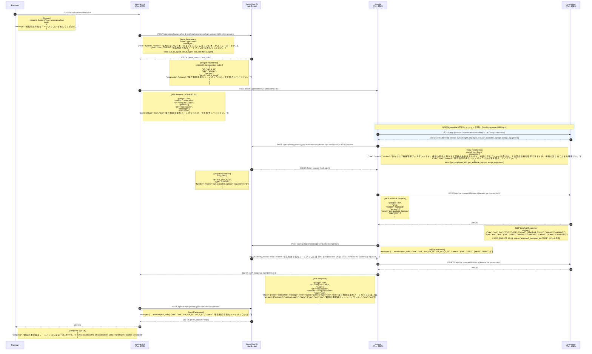

---

## テストケース 3：HR + IT エージェント連携（従業員確認と PC 割り当て）

`main-agent` が `call_hr_agent` と `call_it_agent` を並列呼び出しし、`it-agent` 内で `get_available_laptops` → `assign_equipment` の 2 段階ツール呼び出しを行うシーケンスです。

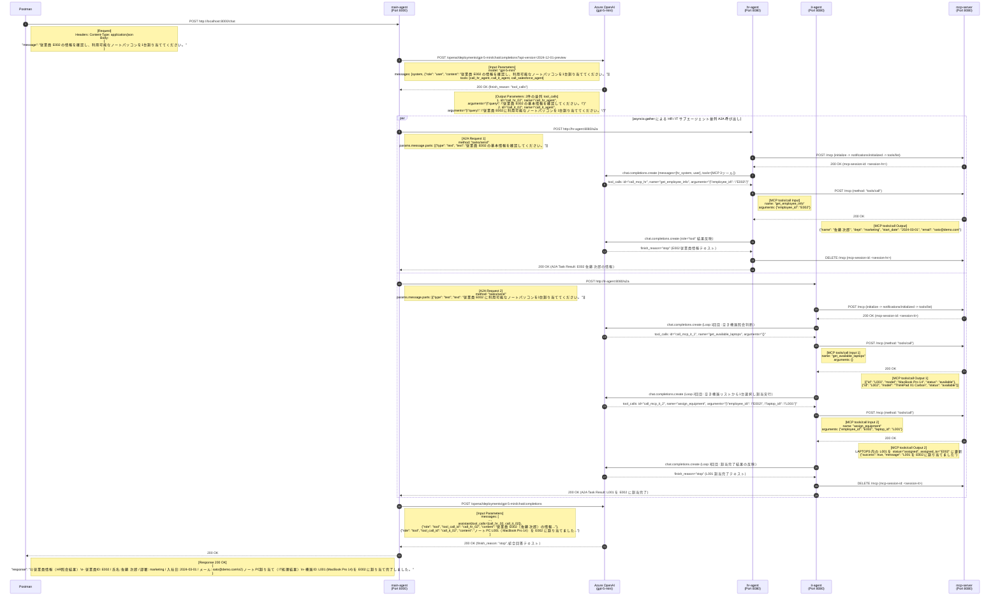

---

## テストケース 4：Salesforce エージェント単体（Salesforce タスク一覧取得）

`main-agent` から `salesforce-agent`（`salesforce_agent/main.py`、`salesforce_agent/agent.py`）へ A2A で委譲し、外部 Salesforce MCP サーバーの `getSFTask` を呼び出すシーケンス（正常系および外部 MCP サーバー到達不能時のフォールバック系の両方を含む）です。

```mermaid
sequenceDiagram
    autonumber
    participant Client as Postman
    participant Main as main-agent<br/>(Port 8000)
    participant AOAI as Azure OpenAI<br/>(gpt-5-mini)
    participant SF as salesforce-agent<br/>(Port 8080)
    participant SFMCP as 外部 Salesforce MCP Server<br/>(CloudHub /mcp)

    Client->>Main: POST http://localhost:8000/chat
    Note right of Client: [Request]<br/>Headers: Content-Type: application/json<br/>Body:<br/>{<br/>  "message": "Salesforce のタスク一覧を取得して整理してください。"<br/>}

    Main->>AOAI: POST /openai/deployments/gpt-5-mini/chat/completions?api-version=2024-12-01-preview
    Note right of Main: [Input Parameters]<br/>model: "gpt-5-mini"<br/>messages: [system, {"role": "user", "content": "Salesforce のタスク一覧を取得して整理してください。"}]<br/>tools: [call_hr_agent, call_it_agent, call_salesforce_agent]

    AOAI-->>Main: 200 OK (finish_reason: "tool_calls")
    Note left of AOAI: [Output Parameters]<br/>tool_calls: [<br/>  {<br/>    "id": "call_sf_01",<br/>    "type": "function",<br/>    "function": {<br/>      "name": "call_salesforce_agent",<br/>      "arguments": "{\"query\": \"Salesforce のタスク一覧を取得して整理してください。\"}"<br/>    }<br/>  }<br/>]

    Main->>SF: POST http://salesforce-agent:8080/a2a (timeout=60.0s)
    Note right of Main: [A2A Request JSON-RPC 2.0]<br/>{<br/>  "jsonrpc": "2.0",<br/>  "method": "tasks/send",<br/>  "id": "<request-uuid4>",<br/>  "params": {<br/>    "id": "<task-uuid4>",<br/>    "message": {<br/>      "role": "user",<br/>      "parts": [{"type": "text", "text": "Salesforce のタスク一覧を取得して整理してください。"}]<br/>    }<br/>  }<br/>}

    alt 正常系：外部 Salesforce MCP サーバーが稼働・到達可能な場合
        SF->>SFMCP: POST https://mulesoft-generative-ai-mcp-server-4aa6a9.zlqs1p.jpn-e1.cloudhub.io/mcp
        Note right of SF: [MCP Handshake & tools/list]<br/>1. initialize -> 200 OK (mcp-session-id)<br/>2. notifications/initialized -> 202 Accepted<br/>3. tools/list -> 200 OK
        SFMCP-->>SF: 200 OK (tools リスト返却)
        Note over SF: list_tools() の結果から<br/>t.name == "getSFTask" のみフィルタリングして openai_tools に登録

        SF->>AOAI: POST /openai/deployments/gpt-5-mini/chat/completions
        Note right of SF: [Input Parameters]<br/>model: "gpt-5-mini"<br/>messages: [<br/>  {"role": "system", "content": "あなたはSalesforceタスク管理アシスタントです。Salesforceのカスタムオブジェクトからタスク情報を取得し、ユーザーに分かりやすく提供します。タスクの項目は、タスク名(Name)、分類(Category__c)、ステータス(Status__c)、予定開始日(Planned_Start__c)、予定終了日(Planned_End__c)、実績開始日(Actual_Start__c)、実績終了日(Actual_End__c)、コメント(Comments__c)です。getSFTaskツールを使ってタスク一覧を取得し、結果をわかりやすく整理して回答してください。"},<br/>  {"role": "user", "content": "Salesforce のタスク一覧を取得して整理してください。"}<br/>]<br/>tools: [getSFTask]

        AOAI-->>SF: 200 OK (finish_reason: "tool_calls")
        Note left of AOAI: [Output Parameters]<br/>tool_calls: [{"id": "call_sftask_01", "type": "function", "function": {"name": "getSFTask", "arguments": "{}"}}]

        SF->>SFMCP: POST /mcp (method: "tools/call")
        Note right of SF: [MCP tools/call Input]<br/>{"name": "getSFTask", "arguments": {}}

        SFMCP-->>SF: 200 OK
        Note left of SFMCP: [MCP tools/call Output]<br/>[{"Name": "...", "Category__c": "...", "Status__c": "...",<br/>  "Planned_Start__c": "...", "Planned_End__c": "...",<br/>  "Actual_Start__c": "...", "Actual_End__c": "...", "Comments__c": "..."}]

        SF->>AOAI: chat.completions.create (role="tool" でタスク一覧JSONを渡す)
        AOAI-->>SF: 200 OK (finish_reason: "stop", 整理済みタスク一覧テキスト)
        SF->>SFMCP: DELETE /mcp
        SF-->>Main: 200 OK (A2A Task Result: status.state="completed", artifacts=[整理済みタスク一覧])
    else フォールバック系：外部 Salesforce MCP サーバーが停止・接続不可の場合
        SF->>SFMCP: POST https://mulesoft-generative-ai-mcp-server-4aa6a9.zlqs1p.jpn-e1.cloudhub.io/mcp (initialize)
        SFMCP--xSF: httpx.ConnectError: All connection attempts failed
        SF-->>Main: 500 Internal Server Error
        Note over Main: _execute_tool_call() が httpx.HTTPStatusError をキャッチし<br/>例外を握りつぶして以下の文字列を返却:<br/>"エラー: Salesforce Agent (http://salesforce-agent:8080) との通信に失敗しました:<br/>Server error '500 Internal Server Error' for url 'http://salesforce-agent:8080/a2a'"
    end

    Main->>AOAI: POST /openai/deployments/gpt-5-mini/chat/completions
    Note right of Main: [Input Parameters]<br/>messages: [..., assistant(tool_calls), {"role": "tool", "tool_call_id": "call_sf_01", "content": "<整理済みタスク一覧 または エラー文字列>"}]

    AOAI-->>Main: 200 OK (finish_reason: "stop", 最終回答または代替案提示テキスト)

    Main-->>Client: 200 OK
    Note left of Main: [Response 200 OK]<br/>{<br/>  "response": "<整理されたSalesforceタスク一覧 または 接続エラー報告と再試行・代替案の案内>"<br/>}
```

---

## テストケース 5：異常系（空メッセージによるバリデーションエラー `400 Bad Request`）

`main_agent/main.py` の入力値検証で弾かれ、Azure OpenAI や各サブエージェントへの通信が発生しないシーケンスです。

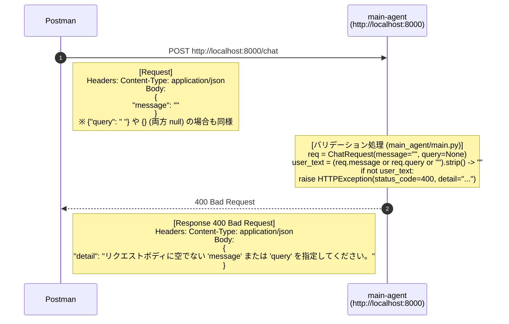

---

# 簡易版シーケンス図（全体通信フロー）

以下は、各ケースの送受信パラメータ詳細を省略し、全体の通信経路と処理の流れを俯瞰するための簡易版シーケンス図です。

---

## 0-A（簡易版）. 【共通】起動時 / 未取得時の Agent Card 動的ディスカバリ

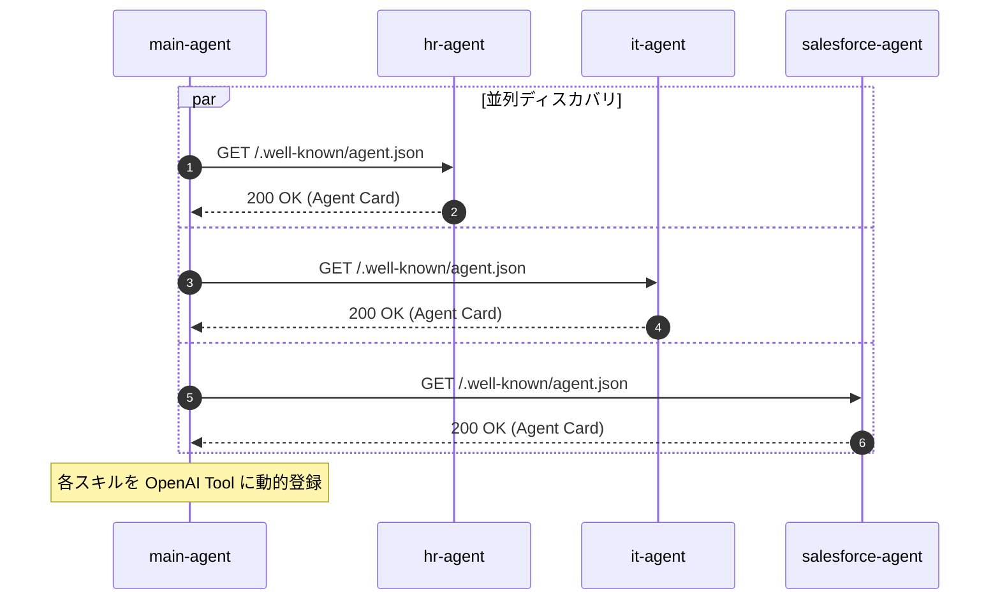

---

## テストケース 0（簡易版）：ヘルスチェック (`GET /health`)

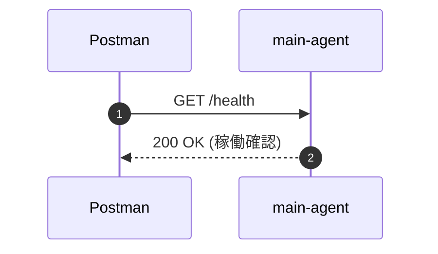

---

## テストケース 1（簡易版）：HR エージェント単体（従業員情報の照会）

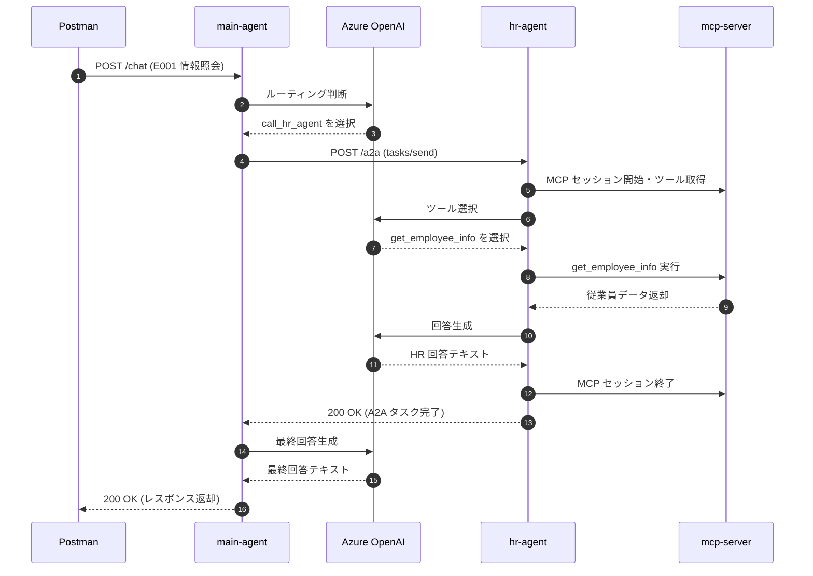

---

## テストケース 2（簡易版）：IT エージェント単体（利用可能なノート PC の照会）

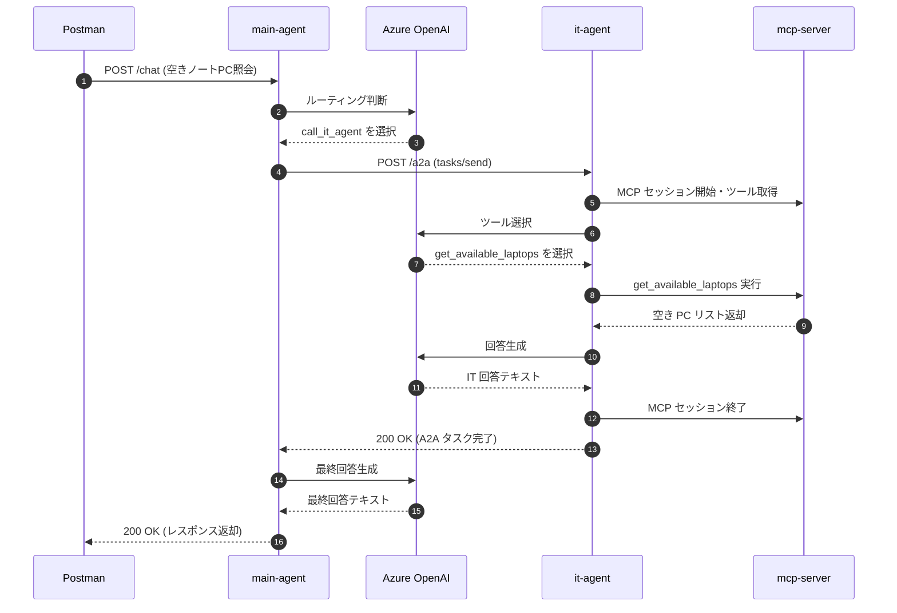

---

## テストケース 3（簡易版）：HR + IT エージェント連携（従業員確認と PC 割り当て）

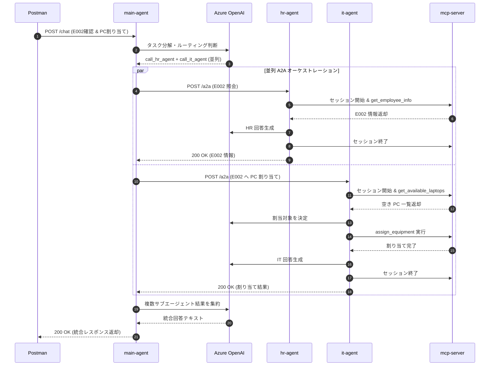

---

## テストケース 4（簡易版）：Salesforce エージェント単体（Salesforce タスク一覧取得）

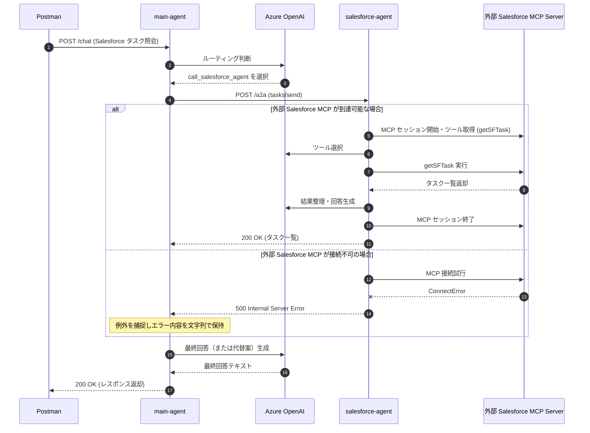

---

## テストケース 5（簡易版）：異常系（空メッセージによるバリデーションエラー）

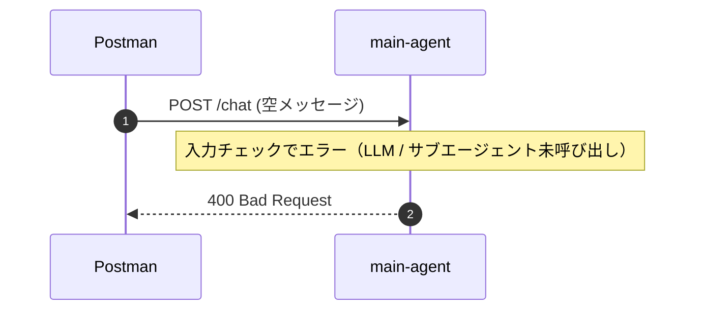
